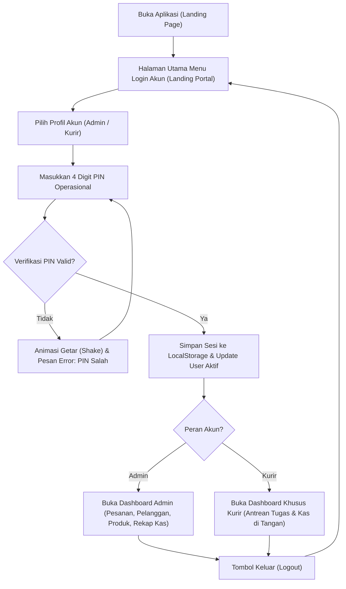

# Rencana & Spesifikasi Aplikasi Asalynn Management Project
## TAHAP 1 — Planning: Cara Kerja Aplikasi Depot Air & Pengantaran Galon

Dokumen perencanaan dan aturan bisnis operasional untuk aplikasi manajemen depot air minum dan pengantaran galon **Asalynn**.

---

### 1. Pengguna Aplikasi (User Roles)

Aplikasi memiliki dua peran (*role*) awal:

| Peran | Perangkat | Tugas & Tanggung Jawab |
| :--- | :--- | :--- |
| **Pemilik / Admin** | HP & Laptop/PC | • Mengelola data pelanggan (nama, nomor WA, alamat lengkap) • Membuat dan menjadwalkan pesanan masuk dari WhatsApp • Mengatur katalog produk & harga (harga standar & harga khusus pelanggan) • Menugaskan pengantaran ke kurir • Melihat laporan harian, mutasi galon kosong, setoran kas, dan piutang |
| **Pengantar (Kurir)** | HP (Tampilan Ringkas & Cepat) | • Melihat daftar tugas pengantaran hari ini • Membuka alamat pelanggan via Google Maps (1 klik) • Menghubungi pelanggan via WhatsApp cepat • Memperbarui status pengantaran di tempat • Mencatat jumlah galon terkirim aktual, galon kosong ditarik, dan pembayaran diterima |

> **Catatan Pelanggan:** Pelanggan **belum perlu memasang aplikasi**. Semua pesanan masuk via WhatsApp dan diinputkan oleh Admin ke dalam sistem.

---

### 2. Alur Transaksi (Transaction Workflow)

Alur transaksi harian berjalan secara berurutan:
1. **Penerimaan Pesanan:** Admin menerima pesanan dari pelanggan lewat WhatsApp atau telepon.
2. **Pilih Pelanggan:** Admin membuka aplikasi dan memilih pelanggan (atau menambah baru jika belum terdaftar).
3. **Pilih Produk & Harga:** Admin memasukkan jenis galon/produk, kuantitas pesanan, dan harga (otomatis menggunakan harga khusus jika pelanggan memiliki tarif khusus).
4. **Jadwal & Penugasan:** Admin menentukan tanggal pengantaran, rentang waktu (opsional), dan memilih kurir pengantar.
5. **Kurir Cek Tugas:** Pengantar membuka aplikasi di HP dan melihat antrean tugas pengantaran hari ini.
6. **Eksekusi Pengantaran:** Pengantar mengantarkan galon ke lokasi pelanggan dengan bantuan navigasi Google Maps.
7. **Pencatatan Lapangan:** Di lokasi, pengantar mencatat:
   - Jumlah galon yang aktual diterima pelanggan.
   - Jumlah galon kosong yang berhasil ditarik/dikembalikan.
   - Jumlah uang yang diterima (lunas, sebagian/tempo, atau transfer).
8. **Rekonsiliasi Pemilik:** Pemilik/Admin memantau hasil secara real-time dari HP sendiri, mencocokkan setoran uang fisik dan saldo galon di depot.

---

### 3. Ruang Lingkup Fitur Versi Pertama (V1 Scope)

Fitur yang diimplementasikan pada versi awal:
- [x] **Login Sederhana:** Akses berbasis peran (Admin & Kurir).
- [x] **Data Pelanggan:** Nama, nomor telepon/WhatsApp, alamat, catatan lokasi, saldo galon pinjaman, dan saldo piutang.
- [x] **Produk & Harga:** Master data produk (Refill galon, galon baru, dll.), harga default, serta fitur harga khusus per pelanggan.
- [x] **Manajemen Pesanan:** Pembuatan pesanan cepat, nomor pesanan otomatis, status pengantaran & status bayar terpisah.
- [x] **Jadwal Pengantaran:** Kalender pengantaran dan filter tugas berdasarkan tanggal & kurir.
- [x] **Penugasan Pengantar:** Alokasi tugas pengantaran kepada kurir yang bertugas.
- [x] **Pembayaran & Piutang:** Pencatatan uang tunai, transfer, status lunas / bayar sebagian / belum bayar (hutang).
- [x] **Pencatatan Galon Kosong:** Buku mutasi keluar-masuk galon fisik pelanggan.
- [x] **Ringkasan Harian (Daily Closing):** Rekap omzet, total galon terkirim, galon kosong kembali, kas di tangan kurir, dan piutang baru.

> **Fitur yang Ditunda ke Versi Berikutnya:**
> - Pelacakan GPS real-time posisi kurir.
> - Aplikasi khusus / portal mandiri pemesanan untuk pelanggan.
> - Optimasi rute otomatis (*auto route routing*).

---

### 4. Aturan Bisnis Baku (Business Rules)

| Topik | Aturan Baku Sistem |
| :--- | :--- |
| **Zona Waktu** | Seluruh catatan waktu, transaksi, dan cut-off harian menggunakan **`Asia/Makassar` (WITA, UTC+8)**. |
| **Penetapan Harga** | Menggunakan harga standar produk secara bawaan; Pemilik dapat menyetel harga khusus untuk pelanggan tertentu (misal: langganan warung/kantor). |
| **Kekekalan Harga Riwayat** | Perubahan harga produk di masa depan **tidak akan mengubah** data nominal transaksi yang sudah terjadi sebelumnya (*price snapshot*). |
| **Status Pembayaran** | Status pembayaran (`LUNAS`, `SEBAGIAN`, `BELUM_BAYAR`) **terpisah** dari status pengantaran (`MENUNGGU`, `DITUGASKAN`, `DALAM_PENGANTARAN`, `SELESAI`, `BATAL`). Barang bisa selesai terkirim meskipun belum dibayar. |
| **Kesesuaian Realisasi Kirim** | Jumlah galon terkirim di lapangan bisa berbeda dari pesanan awal (misal pesan 5, tapi hanya muat atau ada galon kosong 3). Kurir mencatat jumlah aktual (3) dan total tagihan otomatis menyesuaikan barang terkirim aktual. |
| **Pencatatan Galon Kosong** | Galon kosong dihitung independen dari galon yang terjual/terkirim untuk memantau saldo galon depot yang dipinjam pelanggan. |
| **Integritas Pembatalan** | Pesanan batal tidak dihapus permanen, melainkan berstatus `BATAL`. Konfirmasi pembatalan menggunakan dialog ringkas langsung ("Yakin batalkan ya atau oke") tanpa mewajibkan pengetikan teks alasan yang memperlambat kerja. |
| **Reset Global Sistem** | Menu Pengaturan menyediakan opsi Reset Global yang mengembalikan seluruh data transaksi, buku galon, dan piutang ke kondisi data awal bawaan (*factory default*) dengan konfirmasi "Ya / Oke". |
| **Penjadwalan** | Setiap pesanan wajib memiliki tanggal pengantaran, dengan rentang waktu bersifat opsional (contoh: "Pagi 09.00 - 11.00"). |

---

### 5. Skema Struktur Data Utama (Data Entities)

1. **`Pengguna (Users)`**: `id`, `nama`, `telepon`, `peran` (`admin` / `kurir`), `pin`, `kendaraan` (khusus kurir), `aktif`.
2. **`Pelanggan (Customers)`**: `id`, `nama`, `telepon`, `alamat`, `catatan_alamat`, `saldo_galon`, `saldo_piutang`.
3. **`Produk (Products)`**: `id`, `nama_produk`, `harga_standar`, `aktif`.
4. **`Harga Khusus (Customer_Custom_Prices)`**: `id`, `pelanggan_id`, `produk_id`, `harga_khusus`.
5. **`Pesanan (Orders)`**: `id`, `pelanggan_id`, `kurir_id`, `tanggal_antar`, `slot_waktu`, `status_antar`, `status_bayar`, `total_tagihan_aktual`, `catatan`.
6. **`Item Pesanan (Order_Items)`**: `id`, `pesanan_id`, `produk_id`, `harga_satuan`, `qty_pesan`, `qty_terkirim`.
7. **`Pembayaran (Payments)`**: `id`, `pesanan_id`, `pelanggan_id`, `diterima_oleh`, `jumlah`, `metode` (`tunai` / `transfer`), `waktu_bayar`.
8. **`Mutasi Galon (Gallon_Logs)`**: `id`, `pesanan_id`, `pelanggan_id`, `galon_keluar`, `galon_masuk`, `sisa_saldo_galon`, `waktu_catat`.

---

### 6. Spesifikasi & Alur Menu Login Akun (Sistem Autentikasi Pengguna)

Seksi ini menetapkan rancangan kerja, antarmuka, dan keamanan untuk **Menu Login Akun** yang memisahkan akses Pemilik/Admin dan Pengantar/Kurir secara aman dan cepat di lapangan.

#### A. Tujuan & Prinsip Desain Login
1. **Pemisahan Hak Akses (*Role Separation*):** Melindungi data keuangan, laba/rugi, dan master harga produk agar hanya dapat diakses oleh Pemilik/Admin.
2. **Ramah Operasional Lapangan (*Mobile-First Quick PIN*):** Kurir di jalan membutuhkan login cepat 4 digit PIN numerik (bukan password teks panjang) dengan dukungan virtual numpad yang nyaman ditekan di layar HP bahkan dengan satu tangan.
3. **Pilihan Cepat Profil (*Fast Profile Selector*):** Memudahkan pergantian antar kurir atau akses cepat di perangkat tablet/HP depot bersama tanpa perlu mengetik ulang nomor telepon berulang kali.

#### B. Daftar Akun Bawaan (Default Seed Users & Kredensial)

| Nama Akun | Peran | Nomor Telepon | Kendaraan Operasional | PIN Standar | Lingkup Hak Akses |
| :--- | :--- | :--- | :--- | :--- | :--- |
| **Hj. Asmawati (Owner)** | `admin` | `081234567890` | - | **`1234`** | Akses penuh: Pesanan, Pelanggan, Produk & Harga Khusus, Rekonsiliasi Kas Harian, Manajemen Akun. |
| **Daeng Rahmat** | `courier` | `082198765432` | Motor Roda Tiga (Tossa) | **`1111`** | Akses kurir: Daftar tugas antaran Daeng Rahmat, Navigasi Peta, WA Pelanggan, Catat Galon Terkirim/Kosong & Kas Diterima. |
| **Andi Pratama** | `courier` | `085345678901` | Sepeda Motor Obrok | **`2222`** | Akses kurir: Daftar tugas antaran Andi Pratama, Navigasi Peta, WA Pelanggan, Catat Galon Terkirim/Kosong & Kas Diterima. |

#### C. Alur Kerja Autentikasi (Authentication Flow & Landing Page)

**Ketentuan Utama:** Halaman pertama kali saat aplikasi dibuka (**Landing Page**) langsung mengarah ke **Layar Menu Login Akun**. Pengguna tidak langsung masuk ke dashboard apapun sebelum memilih akun dan menginputkan PIN valid.

#### D. Komponen Antarmuka Menu Login & Menu Akun

1. **Halaman Utama Login (Landing Page):**
   - **Header Brand:** Logo Asalynn Depot, Judul *"ASALYNN DEPOT — Manajemen Galon & Pengantaran"*, dan penunjuk waktu zona WITA.
   - **Landing Portal Card:** Kartu login utama yang bersih dan terfokus di tengah layar.
   - **Pilihan Profil Akun (Quick Profile Cards):** Kartu interaktif untuk memilih pengguna (Owner Hj. Asmawati, Kurir Daeng Rahmat, Kurir Andi Pratama).
   - **Indikator Digit PIN:** 4 lingkaran titik (PIN dots) dengan status terisi atau kosong.
   - **Virtual Numpad:** Tombol angka `1` sampai `9`, `0`, tombol `Hapus` (Backspace), dan tombol `Bersihkan`.
   - **Tombol Masuk:** Tombol konfirmasi masuk aplikasi dengan umpan balik visual instan.
   - **Bantuan / Demo Helper:** Informasi kartu petunjuk PIN demo bawaan untuk kemudahan pengujian langsung.

2. **Menu Akun di Header Aplikasi (Saat Sudah Login):**
   - **Pill Profil Pengguna Aktif:** Berada di sudut kanan atas header. Menampilkan:
     - Badge Avatar Ikon (`👑` untuk Admin, `🛵` untuk Kurir).
     - Nama Pengguna yang sedang aktif.
     - Label peran (`Admin` / `Kurir`).
   - **Dropdown / Panel Menu Akun:** Saat pill profil diklik, muncul menu ringkas:
     - Kartu Ringkasan Akun: Nama lengkap, nomor WhatsApp, peran, dan kendaraan kurir.
     - Ringkasan Cepat: Total kas di tangan (untuk kurir) atau ringkasan omzet hari ini (untuk admin).
     - Tombol **"Ganti Akun"**: Membuka modal/tampilan ganti akun tanpa menghapus data operasional.
     - Tombol **"Keluar (Logout)"**: Menghapus sesi aktif dari perangkat dan mengembalikan tampilan secara penuh ke **Landing Page Menu Login**.

#### E. Aturan Keamanan & Sesi (Security & Session Rules)

1. **Persistensi Sesi (*Session Persistence*):**
   - Sesi pengguna tersimpan di `localStorage` peramban.
   - Jika kurir menutup browser untuk membuka Google Maps atau WhatsApp pelanggan, saat aplikasi dibuka kembali kurir **tidak perlu memasukkan PIN ulang** sehingga tidak mengganggu kecepatan kerja di jalan.
2. **Isolasi Rute & Hak Akses Kurir (*Strict Role Isolation*):**
   - Saat login sebagai Kurir, tab navigasi admin (*Pesanan & Antaran*, *Pelanggan & Piutang*, *Produk & Harga*, *Rekonsiliasi & Kas Harian*) disembunyikan.
   - Kurir hanya melihat daftar pesanan yang ditugaskan kepada dirinya sendiri pada tanggal yang dipilih.
   - Kurir tidak dapat melihat atau mengubah harga modal/dasar produk depot.
3. **Otoritas Pemilik (*Admin Control*):**
   - Akun Admin memiliki kendali penuh untuk melihat seluruh kurir, menugaskan pesanan ke kurir mana pun, serta melakukan penutupan kas harian (*daily closing*).
4. **Keamanan PIN Lapangan:**
   - PIN disamarkan (*masked*) pada saat pengetikan.
   - Validasi dilakukan secara lokal instan dan disiapkan untuk integrasi enkripsi/hash pada backend di fase produksi berikutnya.

